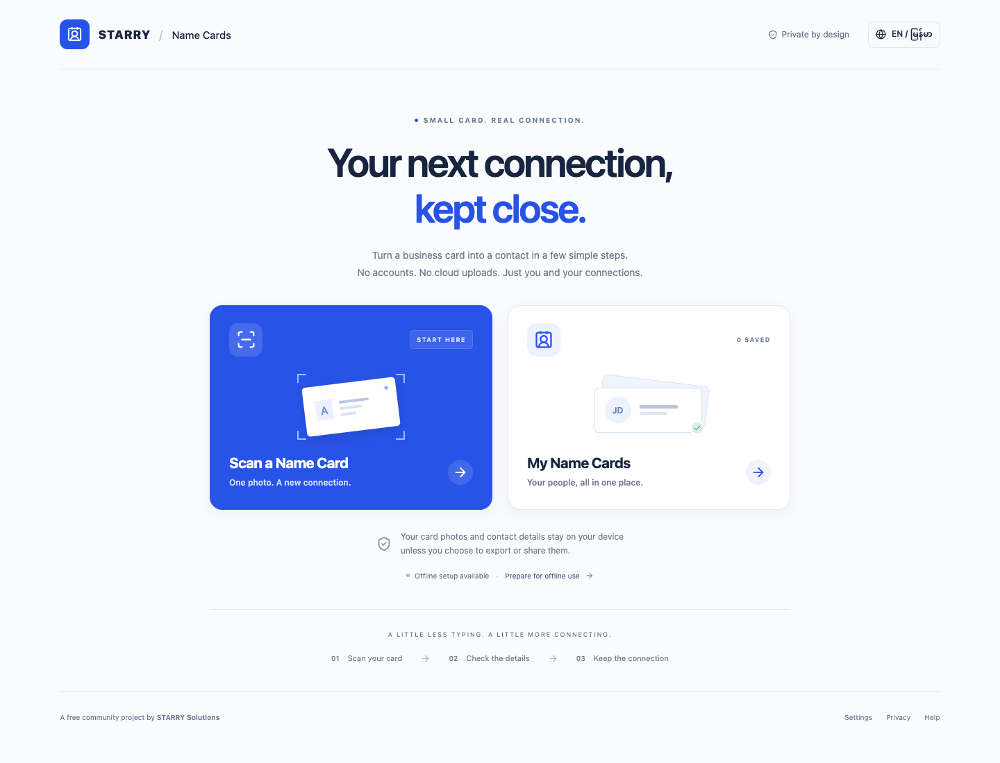

# STARRY Name Cards

[Open the app](https://cards.starrymm.com) · [Production hosting](docs/DEPLOYMENT.md)

A free community project by STARRY Solutions. Turn a physical business card into a digital contact using OCR on your own device. No account, backend, cloud OCR, analytics, or paid service is required.

**Your card photos and contact details stay on your device unless you choose to export or share them.** Ordinary hosting access logs may exist when loading the app online; see [Privacy](PRIVACY.md).



## Run locally

Use Node.js 22.12 or newer and npm. The lockfile pins the dependency graph.

```sh
npm ci
npm run setup:ocr
npm run dev
```

The OCR setup step downloads English and Myanmar model assets and copies installed OCR worker/WASM assets into the local public directory. This is a developer/build-time download; end users receive these assets from the same static host as the app. Do not replace those paths with a third-party CDN. Keep asset notices with redistributed builds.

```sh
npm run lint
npm run typecheck
npm test
npm run build
npx playwright install chromium
npm run test:e2e
npm run test:subpath
```

See the [verification report](docs/VERIFICATION.md) for executed checks and [manual verification](docs/QA_CHECKLIST.md) for pending physical-device checks.

## Test on another Wi-Fi device

Build the app, then keep the preview server running:

```sh
npm run build
npm run preview:lan
```

Open the Network address printed by Vite on a phone connected to the same Wi-Fi. Allow local-network access if your firewall asks. Guest Wi-Fi or client isolation can prevent devices from reaching each other. The network address can change when you reconnect.

An HTTP network address supports screen and local-contact testing, but full PWA installation and service-worker offline functionality require HTTPS. For those device checks, use a trusted HTTPS testing host. Localhost's secure-context exception applies only on the device running the server.

In **More**, choose **Add to home screen**. Supporting browsers display their installation prompt; otherwise STARRY shows iPhone/iPad, Android or desktop directions. Browser menu availability varies. After installation, prepare offline assets in Settings.

Storage is separate for each origin: localhost, the network IP and an HTTPS host do not share saved contacts. Use a backup to transfer fictional test data between them.

## App navigation

The persistent app navigation contains **Home**, **Connections**, **Settings**, and **More**. More contains Profile, Privacy, About, Help, backup/export actions, the GitHub repository and installation guidance. The optional local profile needs no account and is excluded from contact backups.

Each screen has a distinct URL: `/#/home`, `/#/connections`, `/#/settings`, `/#/more`, `/#/profile`, `/#/privacy`, `/#/about`, `/#/help`, `/#/scan` and `/#/review`. Saved connections use `/#/connections/<local-id>`. Hash routes support direct opening, reloads and browser back/forward without static-host rewrite rules, including under a subdirectory and offline. URLs never contain contact details. Unsaved review drafts are not restored after a reload.

## Use

1. Choose **Scan a Name Card** and take or choose a photo, or enter details manually.
2. Select the OCR recognition language independently of the interface language. Download English and Myanmar together while online.
3. Read the card, then correct the suggested fields. OCR and field assignment can be wrong; no missing information is invented.
4. **Save to My Name Cards** stores a record in this browser. Photo retention is optional and off by default.
5. **Download Contact (.vcf)** exports a contact without implicitly saving it. **Share Contact** uses supported device sharing, with a download fallback. Your operating system controls contact import.

VCF files use UTF-8 vCard 3.0. Full names are kept intact; structured given/family names are optional and never inferred. Photos are excluded from contact exports. JSON backup is the format for restoring the app collection; multi-contact VCF is for importing into a contacts application. Backups and exports are **unencrypted**. Keep them somewhere you trust.

## Offline and storage

Prepare the app and both OCR language packs online before going offline. The connection indicator and verified offline-readiness status mean different things. A missing model prevents that language's OCR, but manual entry remains available. Browser eviction, private browsing, or clearing site data can remove downloaded assets and saved contacts.

Cards are stored in IndexedDB on the current browser/device. They do not sync. Retained photos increase storage use. Export backups regularly; browser storage is not a permanent backup. Deleting local data does not delete exported/shared files. Updates should be activated when you are ready, after saving or exporting edits.

## Build and deploy

```sh
npm run setup:ocr
npm run build
```

Run `npm run preview` to inspect the production build locally, including service-worker/offline behavior. The development server intentionally does not register a service worker.

Deploy the entire `dist/` directory, including OCR assets, manifest, service worker, and notices, to a static HTTPS host. Localhost also supports service-worker development. No application server or API key is needed. Serve WASM as `application/wasm`; do not rewrite asset requests to HTML. Use revalidation/no-cache for the service worker and entry HTML so update checks work. Preserve the document Content Security Policy; review any host header policy against local worker/WASM execution.

For hosting under a subdirectory, set the build base including trailing slash:

```sh
VITE_BASE_PATH=/name-cards/ npm run build
```

The public source repository is [ChanMyaeLwin/starry-name-cards](https://github.com/ChanMyaeLwin/starry-name-cards). Forks can override the in-app source link with `VITE_SOURCE_URL`. Never put secrets in `VITE_*` variables: they are public build inputs. The source repository is public. The production app is hosted at https://cards.starrymm.com; see [deployment notes](docs/DEPLOYMENT.md).

## Limitations and release checks

English OCR still needs review, especially small type, glare, unusual layouts, and stylized fonts. Myanmar recognition is experimental; a downloadable model does not establish real-world accuracy. Myanmar interface translations require human review. The app uses device fonts rather than remote fonts. HEIC input is not supported; convert it to JPEG/PNG before trying again.

Desktop automated browser checks do not establish iPhone, Android, installed-PWA, contact-import, or Myanmar accuracy compatibility. Follow [the checklist](docs/QA_CHECKLIST.md) and record browser/OS versions before advertising compatibility. See [project requirements](PROJECT_GUIDELINES.md) for the original specification.

## Contributing and license

Contributions are welcome from everyone, including code, translations, accessibility feedback, and documentation. See [Contributing](CONTRIBUTING.md), [Code of conduct](CODE_OF_CONDUCT.md), and [Security](SECURITY.md). Project code is licensed under [MIT](LICENSE), attributed to STARRY Name Cards contributors. Maintainers can update that attribution if a confirmed legal rights holder requires it; the brand name is not assumed to be a legal entity. Third-party code and OCR assets retain their own licenses; see [notices](THIRD_PARTY_NOTICES.md). The About page displays the STARRY Solutions logo supplied by the project owner.
